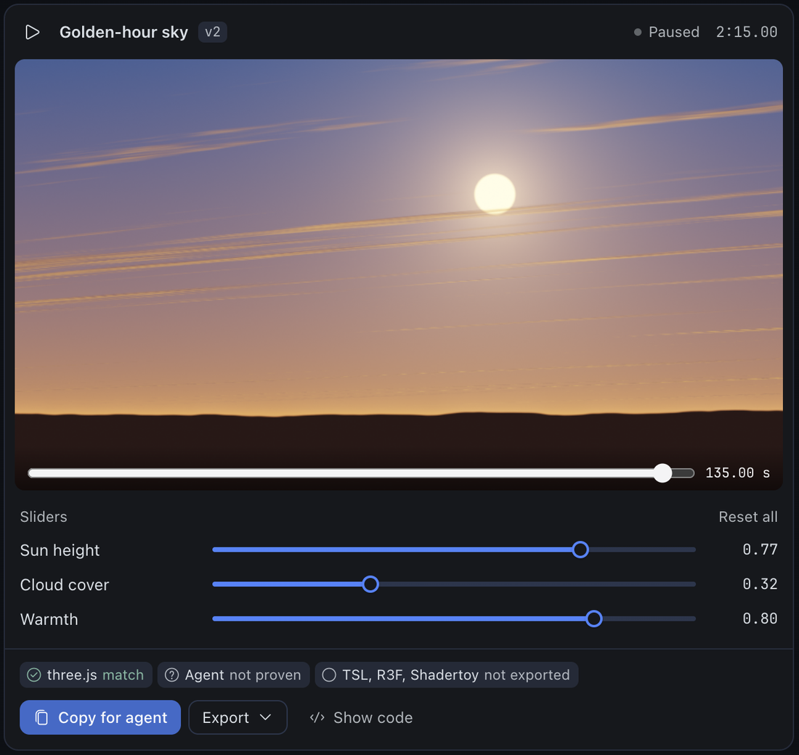

# Shaderbrücke

Make GLSL shaders with your Hermes agent, see them render, tune them by hand, and take them into the
tool you ship in.

Shaderbrücke is a lab, not a generator. You describe a look, the agent writes the shader, a
headless browser on the Hermes host compiles and renders it, the agent looks at its own frames and
fixes them, and Hermes Desktop plays the checked result live in the chat with sliders under it.
When the shader is right, `shader_export` writes files that drop into three.js, React Three Fiber,
TSL, Shadertoy, TouchDesigner or an ISF host, and renders the export next to the source to prove it
looks the same. Every shader stays in a library you browse, fork, edit and share.

Built for three.js and React Three Fiber developers first, and TouchDesigner / VJ artists second.



## Changes

- **0.2.0:** a Shaders page in Desktop with every shader as a thumbnail, its versions, forks,
  licence and lineage; the Lab, where you edit the code yourself beside the chat and save it as a
  version the agent hears about; `@shader:` references in any chat; share files and import of
  Shadertoy, glslCanvas and ISF shaders with their licence; a licence picker; and two new export
  targets, TouchDesigner GLSL TOP and ISF.
- **0.1.1:** the card plays during a live turn, not only after a reload; the first render works
  on a fresh profile; the human's slider values are saved and become the export defaults; a
  shader that declares a slider name again is stopped by the lint; the render result says whether
  the frames move (`checks.motion`). The fixes came from a code review and a check in Hermes
  Desktop on a Mac (Apple Metal 3).
- **0.1.0:** first release.

## The loop

1. **Ask.** "A golden-hour sky with a low sun and slow clouds."
2. **Render.** `shader_render` lints the source (unbounded loops, WebGL1 names, redeclared
   uniforms), compiles it in a short-lived Chromium, renders three frames (t = 0, 1, 2.5 s), builds
   a contact sheet, and measures whether the frames are flat, black, full of NaN, still, or a flash
   risk.
3. **Look.** The agent calls `vision_analyze` on the contact sheet before it says anything about the
   result. A render nobody looked at is not a result.
4. **Fix.** Compile errors come back with the agent's own line numbers; flat frames come back with
   the reason. The loop runs until the checks and the frames agree.
5. **Play and tune.** A `MEDIA:` line puts the shader in Desktop, where it runs live and every
   `@slider` becomes a slider you move without another agent turn. Your values are saved and used
   by every export.
6. **Export.** One target's files, the integration steps, and a proof verdict. From the agent, or
   from the card's Export menu.

## The card in Desktop

- A header with play and pause (also Space), the shader's name, its version and the time.
- The live canvas. While paused, a scrub bar sets the time, so you can look at any moment.
- The sliders, with readable labels, the step's precision, Reset all, and a double-click on a label
  to reset one slider. "Saved, used in exports" confirms each change.
- A proof strip: each target's latest verdict in words (`match`, `differs`, `not proven`,
  `not exported`).
- **Copy for agent** copies the handoff block. **Export** lists every target: copy the file, send it
  to the chat, export it now, or ask Hermes.
- **Show code** opens the source with line numbers and the lint markers.
- With reduced motion turned on, the card shows a still frame until you press play.

## Sliders

```glsl
// @slider cloudCover 0.0..1.0 = 0.55 step 0.01 "Cloud cover"
```

Up to 16 per shader. The quoted label is optional; without it the card makes one from the name.
Sliders become uniforms in every export (three.js uniforms, R3F props, Shadertoy `const float`s,
TSL uniforms). When you tune a slider in Desktop, exports, the handoff and the proof use your value,
and each file's header lists both: `cloudCover 0..1 (default 0.55, tuned 0.4, step 0.01)`.

## Targets

| Target | Files | Proof |
|---|---|---|
| `three` | `<Name>Material.js` (ShaderMaterial factory) + `<Name>.frag.glsl` | rendered in an offline three r187 harness |
| `r3f` | `<Name>.tsx` (component, `<Name>Background` for an existing Canvas) + the material module | the material factory's proof; the `.tsx` wrapper itself is not rendered |
| `tsl` | `<Name>.tsl.js`, generated by three r187's own transpiler | rendered through `WebGPURenderer`; experimental, a shader the transpiler cannot express is refused with the reason |
| `shadertoy` | a paste-ready Image tab | the tab itself is rendered and compared |
| `agent` | `<Name>.handoff.md` (one Markdown block) + `reference-t1.png` | the material module embedded in the block is rendered |
| `td` | `<Name>.td.glsl`, a TouchDesigner GLSL TOP pixel shader; the steps list the Vectors page rows (`iTime` = `absTime.seconds`, one per slider) | rendered in a WebGL2 shim of the GLSL TOP's wrapper; experimental until checked in TouchDesigner |
| `isf` | `<Name>.fs`, an ISF 2.0 generator (VDMX, Resolume Wire, ISF Editor), sliders as float INPUTS; no audio yet | rendered in a WebGL2 shim of an ISF host's wrapper (VVISF's GL3 / ES3 path); experimental until checked in a host |

Every export file starts with a header that states its own contract: name, `id@version`, target,
the uniform contract, the sliders with ranges and values, provenance, licence, and a credit line you
can turn off (`credit_line: false`). The handoff ends with an acceptance check any agent can run on
its own machine: the mean colour of a 3x3 grid at t = 1 s, as numbers.

## Proof, not promises

Each export is rendered next to the source at t = 0.5, 1 and 2 s, once with the effective slider
values and once with every slider at a quarter of its range. Each export carries a verdict:

- **match**: every check agrees with the source (mean ≤ 2/255, p99 ≤ 8/255).
- **differs**: both rendered and at least one check does not agree; the result names the check,
  the numbers and both frames.
- **not_proven**: it could not be checked (a compile failure, a harness that did not load); the
  reason is always in the result.

A silent pass does not exist. When you pass `dest_dir`, files are copied into your project only
after a `match`, or when you say `accept_unproven=true`, and the result says which.

## The Shaders page

A **Shaders** row in Desktop's sidebar (and in the command palette) opens the library:

- Every shader as a thumbnail with its name, version count, last edit, states (flat, flash
  warning, imported), licence and lineage. Grid or list, search, filters (state, licence, tag,
  starred, archived), sort by last edited, created or name.
- Hover or focus plays one shader live; everything else stays a still. Shaders with a flash
  warning and reduced motion never autoplay.
- "Pick up where you left off" puts the last few shaders you touched first. An empty library
  shows the first prompt to try.
- The detail sheet: the big live canvas with play, pause and scrub, the sliders, a filmstrip of
  every version (who wrote it, its states), any two versions compared side by side with a source
  diff and the slider changes, lineage (parent and forks), the licence picker, rename, tags, star,
  archive, and delete from the archive with the name typed.
- **Continue in chat** opens a chat with `@shader:<id>@v<n>` drafted. **New shader** opens a chat
  with a starter. **Fork**, **Edit in Lab**, **Export** and **Share file** are one click away.
- Shaders from an older install that have frames but no record show up in a banner: adopt them on
  one click (each is re-rendered into v1); the ones that fail today's checks are listed with the
  reason and never touched.

## @shader: references

Type `@shader:` in any chat and pick a shader. On send it expands, for the agent only, into the
name, version, source and sliders in full, your tuned values, and one line each for licence,
lineage and the checks. `@shader:<id>@v2` points at an older version.

## The Lab

**Edit in Lab** opens the code beside the chat (docked right) or as a tab next to it; the choice
is remembered. Line numbers and error markers, the same lint and a local recompile on every
change, the sliders and the scrub bar. A learn view shows the agent's explanation beside the line
it explains. Unsaved text is kept per shader until you save.

**Save** lints and renders your source on the server like the agent's; a compile error comes back
with its line and makes no version. A save becomes the next version with your name on it
(`author_kind: human`), and the agent's next turn starts with one line about your edit. If the
agent wrote a newer version while you edited, the Lab says so instead of overwriting it.

## Library

`shader_library` lists (with the page's filters), gets, forks, renames, tags, archives and
unarchives shaders, sets a licence, imports and shares; the agent has no delete. Every successful
render is a version under `plugin_data_dir()/shaderbruecke/shaders/<id>/v<n>/`, with its source,
sliders, tuned values, checks, contact sheet, a 320x180 `thumb.webp` and provenance.
`shader_render(id=…)` keeps a new version; `shader_render(parent_id=…)` and `shader_library(fork)`
keep lineage. Failed renders go to a scratch folder and never take a version number.

`hermes shaderbruecke thumbs` backfills thumbnails for versions made before 0.2, and
`hermes shaderbruecke adopt` adopts the folders the banner offers. Both run as resumable jobs.

## Licences, share files and import

- **Licence picker.** Private by default. Pick MIT, CC0, CC BY, CC BY-SA, CC BY-NC or CC BY-NC-SA
  for your own shaders; versions made after the change and every export from them carry it, older
  versions keep theirs. An imported shader's NC or SA licence is inherited and cannot be dropped.
- **Share files.** `<name>.shaderbruecke.json` (format `shaderbruecke/1`): source, sliders, tuned
  values, licence, author (the `author_name` and `author_url` settings), whether an AI wrote it,
  lineage and a thumbnail. Save one into a folder you pick; anyone with Shaderbrücke imports it.
- **Import.** A share file, or a pasted Shadertoy, glslCanvas or ISF shader with its source URL,
  author and licence. Single-pass generators only: multipass, textures, audio and image inputs are
  refused with the reason. A pasted Shadertoy shader with no licence named gets Shadertoy's default,
  CC BY-NC-SA 3.0, with a warning. Every import is linted and rendered before it lands, and it
  plays only when it passed. Nothing is fetched from the network.

## Learn mode

Ask "why does this line make the sun glow?" and the agent explains the lines it names, ties them to
a slider, offers an exercise with a hint instead of the answer, and never rewrites your code
without asking.

## Requirements

Hermes 0.22.7 or newer and a Chromium. The Hermes container image ships one, and the plugin finds it
on its own. Elsewhere, put `chromium` on `PATH` or point `SHADERBRUECKE_CHROMIUM` at the binary.
Without a Chromium every render answers `no_browser`. No GPU, no Python dependencies, no npm.

## Disclosures

- **A Chromium child process.** Each render or proof starts Chromium
  (`--headless=new --remote-debugging-pipe`) with a throwaway profile, `--no-sandbox` (it runs as
  the Hermes user in a container), `--enable-unsafe-swiftshader` (software GL: no GPU is required),
  and `--host-resolver-rules=MAP * ~NOTFOUND`, so **the network is blocked** (host names and IP
  addresses alike). `--webrtc-ip-handling-policy=disable_non_proxied_udp` closes the UDP path
  WebRTC would otherwise have; a probe sent STUN to an IP literal and nothing arrived. Proofs open
  the plugin's own `headless/harness.html` from disk and add
  `--allow-file-access-from-files` so it can load the vendored three.js. The child gets only PATH,
  locale and a short temp folder from the environment, never the gateway's API keys. It starts
  through a one-line `/bin/sh` launcher that turns core dumps off and runs it inside its throwaway
  profile. A hard deadline (30 s per render, 90 s per proof) kills the whole process group. At most
  two children run at a time per profile; a third call waits up to 120 s and says so. Shader code
  never leaves the machine.
- **Vendored three.js r187 (MIT, 4.5 MB).** `headless/vendor/three-r187/` carries the three build
  files and the transpiler unmodified, used **only server-side** for proofs and the TSL transpile.
  Nothing is served to a browser. Three files exceed the security scanner's 1 MB per-file limit, so
  their upstream SHA-256 is listed here:

  | File | SHA-256 |
  |---|---|
  | `build/three.core.js` | `613e370f76638fdef83926642bf256dc9615684922de1ce1f63a8583e5d78578` |
  | `build/three.module.js` | `104f56145899722094556490d787aae0617cc2fc3382f31df02d724ea1aee341` |
  | `build/three.webgpu.js` | `eafead3154ec06093f3108bddceab360f048a6fcebd7c085d5aae0ab5404bd25` |
  | `build/three.tsl.js` | `d8f3cdb8b85b799a5631bd9a8d77e185d88ce1eb1bb051f48b332728a5423e3f` |

- **Writes.** Shader records, frames and exports go under `plugin_data_dir()` (the profile's plugin
  data folder). A version with its frames and proof images takes 1 to 3 MB; the frames of all but
  the newest `keep_versions` versions per shader are pruned, and sources, records and export files
  stay. `shader_export(dest_dir=…)` writes into a project folder only when you pass an absolute,
  existing directory, never overwrites unless `overwrite=true`, copies only proven files unless
  `accept_unproven=true`, and is refused in unattended runs unless you turn `allow_project_writes`
  on. Under `plugins.isolation: host` the plugin cannot tell a one-shot `hermes -z` run from a
  terminal chat, so there it refuses `dest_dir` on the terminal surface too (Desktop still works).
  Names, authors and other text that enter a generated file are cleaned of line breaks and
  comment terminators, so they cannot add code.
- **No telemetry, no accounts, no network calls.** There are no credentials to configure.
- **Desktop half.** Draws the `.frag` the tool produced, runs the same lint locally before a local
  compile, and talks only to the plugin's own API (`/api/plugins/shaderbruecke/…`) to read the
  library, targets and proofs, save slider values, meta and Lab versions, and run an export or an
  import. Share files are read and written only in a folder you pick. It never `eval`s
  shader-adjacent code.
- **A context reference and a hook.** `@shader:` expands only in the profile that has the plugin,
  with that profile's library. A `pre_llm_call` hook adds one line to the agent's next turn after
  you save in the Lab; it adds nothing otherwise.

## Settings

| Setting | Default | What it does |
|---|---|---|
| `allow_project_writes` | `false` | Allow `shader_export(dest_dir=…)` during unattended runs (cron, webhook, single query). |
| `credit_line` | `true` | Append "Made with Shaderbrücke" to export headers. Author and licence lines always stay. |
| `keep_versions` | `5` | Keep frames and proof images for the newest N versions of each shader. |
| `author_name` | empty | Your name in export headers and share files. |
| `author_url` | empty | A web link (http or https) next to your name. |

Settings apply to the next call; no reload is needed.

## Install

```bash
hermes plugins install https://github.com/studioluftbruecke/shaderbruecke --ref <sha>
```

## Licence

MIT. Made by Studio Luftbrücke.
