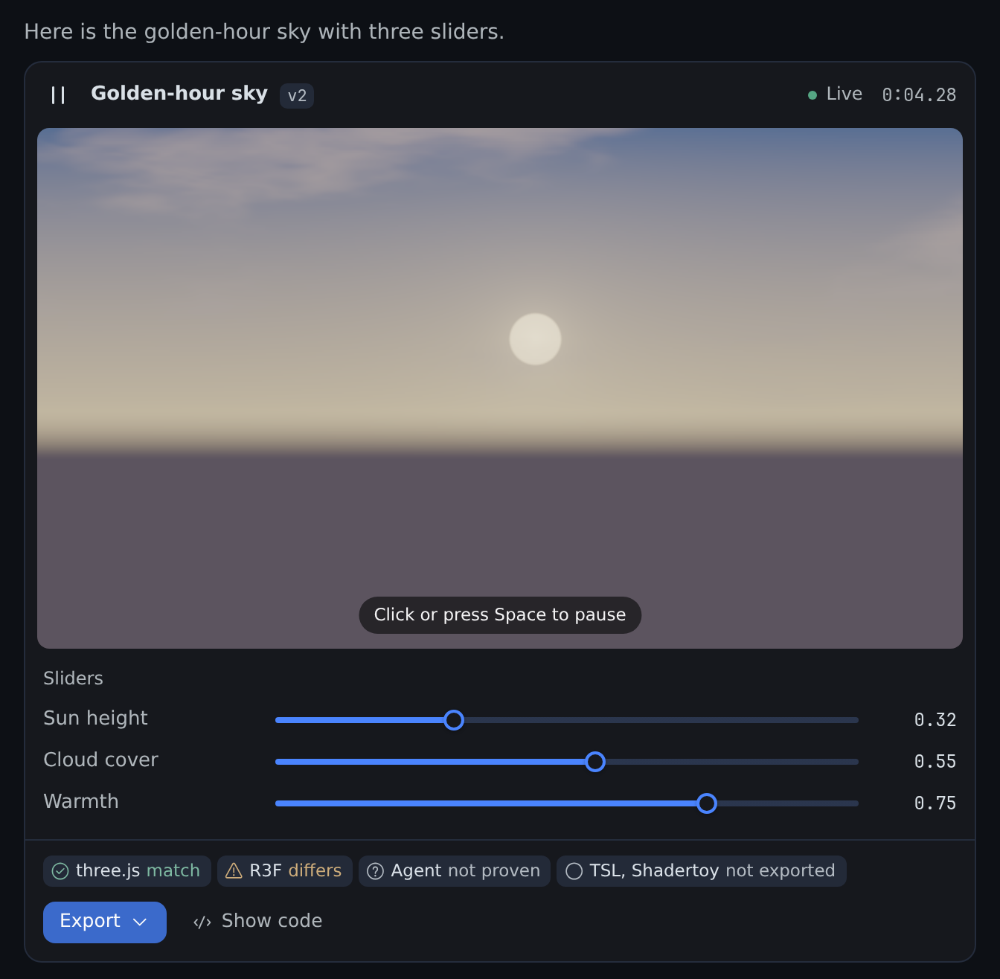
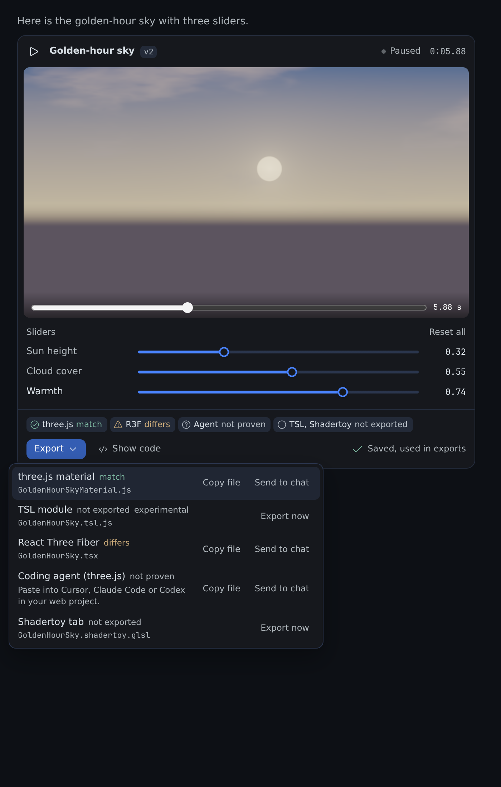
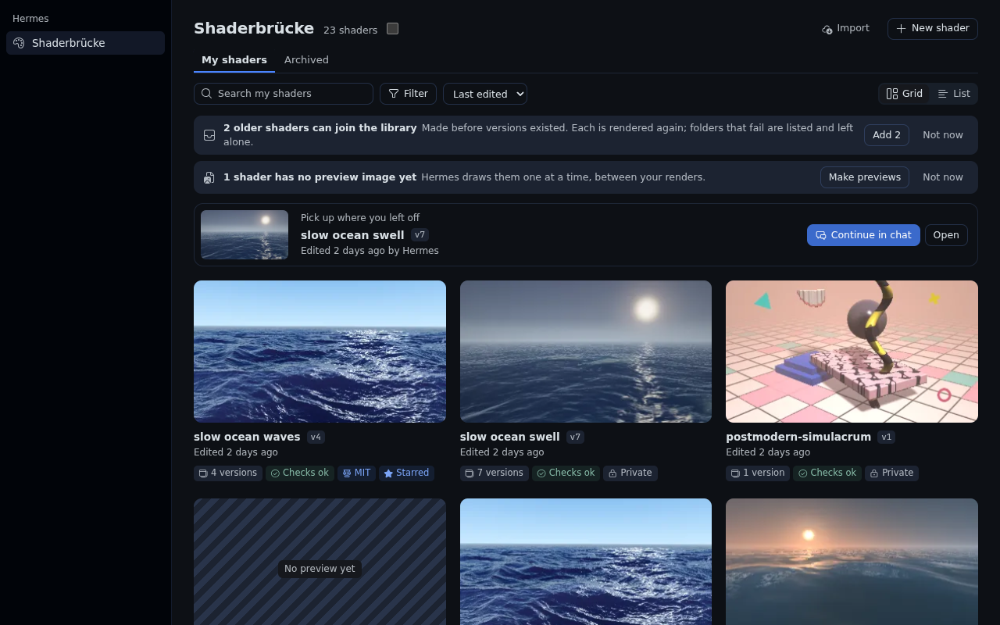
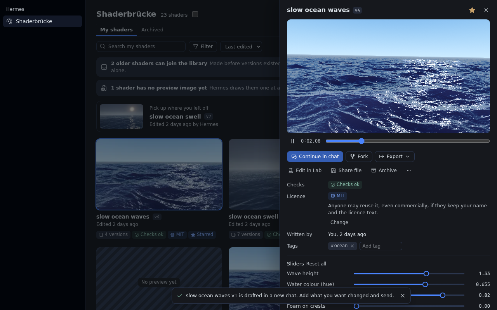
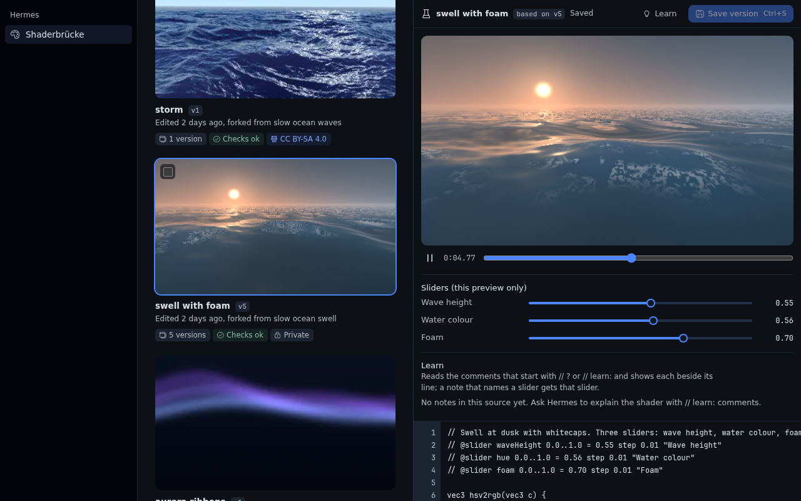

# Shaderbrücke

A shader lab where your Hermes agent checks its own work: it writes a GLSL shader, renders it, looks
at the frames, fixes them, and hands you a live card with sliders and exports that prove themselves.



## What it does

- **Checked before you see it.** A headless Chromium on your Hermes host lints, compiles and renders
  three frames. The agent looks at its own contact sheet and fixes flat, black or still frames
  before it answers.
- **Live in the chat, with sliders.** Hermes Desktop plays the shader in the chat. Each `@slider`
  line becomes a slider you move without another agent turn. Your values become the export defaults.
- **Exports that prove themselves.** three.js, React Three Fiber, TSL, Shadertoy, an agent handoff,
  and experimental TouchDesigner and ISF. Each export is rendered next to the source and gets a
  verdict: `match`, `differs` or `not_proven`. A silent pass does not exist.
- **A library you own.** Every render is a version with its frames, forks and licence. Browse it on
  the Shaderbrücke page, edit the code yourself in the Lab, import Shadertoy, glslCanvas and ISF shaders,
  and share a file anyone with Shaderbrücke can import.

Built for three.js and React Three Fiber developers first, and TouchDesigner and VJ artists second.
The full feature guide is [`docs/guide.md`](docs/guide.md).

| | |
|---|---|
|  |  |
|  |  |

## Install and update

```bash
hermes plugins install https://github.com/studioluftbruecke/hermes-shaderbruecke --enable
```

Hermes Desktop loads the card and the Shaderbrücke page (`desktop/plugin.js`) from the computer it runs
on. When Hermes runs on a server, install the plugin in both places, on the same version:

| Where | Install | Update |
| --- | --- | --- |
| Server: tools, renderer, routes | `hermes -p <profile> plugins install https://github.com/studioluftbruecke/hermes-shaderbruecke --enable` | `hermes -p <profile> plugins update shaderbruecke` |
| Desktop computer: card and the Shaderbrücke page | `hermes plugins install https://github.com/studioluftbruecke/hermes-shaderbruecke` | `hermes plugins update shaderbruecke` |

- After either step on the Desktop computer: Capabilities → Plugins → Rescan. A new install's
  Desktop half arrives switched off; switch it on there.
- No Hermes on the Desktop computer: Capabilities → Plugins → Install from Git with the URL; to
  update, the same with Advanced → Force reinstall. Desktop's Update button updates the server only.
- After an update on the server, Desktop chats and the plugin's routes keep the old code: in
  Capabilities → Plugins, switch **Agent in <profile>** off and on, then start a new chat.
- Same version in both places? Compare the Version column of `hermes plugins list` on the Desktop
  computer and `hermes -p <profile> plugins list` on the server, or run
  `git -C ~/.hermes/profiles/<profile>/plugins/shaderbruecke log -1 --oneline` on each
  (`~/.hermes/plugins/shaderbruecke` for the default profile).
- The sidebar switch and position on the plugin's settings page are kept per Desktop, so a second
  computer starts with the defaults.

**Requirements.** Hermes 0.23.0 or newer and a Chromium. The Hermes container image ships one, and
the plugin finds it on its own, and on a Mac it finds Chromium or Google Chrome in `/Applications`.
Elsewhere, put `chromium` on `PATH` or point `SHADERBRUECKE_CHROMIUM` at the binary. Without a Chromium every render answers `no_browser`. No
GPU, no Python dependencies, no npm.

## First use

1. Ask in a chat: "A golden-hour sky with a low sun and slow clouds, with sliders for sun height and
   warmth."
2. Watch the card: the agent renders, looks at the frames, fixes what fails, and the card plays the
   result. Move the sliders.
3. Ask "export it for three.js", or use the card's **Export** menu. The answer carries the files, the
   steps and the proof verdict.

## Settings

| Setting | Default | What it does |
|---|---|---|
| `allow_project_writes` | `false` | Allow `shader_export(dest_dir=…)` and `shader_library share(dest_dir=…)` during unattended runs (cron, webhook, single query). |
| `credit_line` | `true` | Append "Made with Shaderbrücke" to export headers. Author and licence lines always stay. |
| `keep_versions` | `5` | Keep frames and proof images for the newest N versions of each shader. |
| `author_name` | empty | Your name in export headers and share files. |
| `author_url` | empty | A web link (http:// or https://) next to your name. |
| `starter_prompt` | `true` | Start a new shader chat from the Shaderbrücke page with one of the example prompts; off starts an empty chat. |

Settings apply to the next call; no reload is needed.

In Desktop, Settings → Plugins → Shaderbrücke holds the sidebar row: **Show in the sidebar** and
**Position** (lower numbers sit higher). The settings above are beneath it, under **Agent settings**.

## Safety and disclosures

- **A Chromium child process.** Each render or proof starts Chromium
  (`--headless=new --remote-debugging-pipe`) with a throwaway profile and Chromium's own sandbox.
  Where the sandbox cannot start (a container that refuses user namespaces, a root user), the
  first start in a process fails at once and the child runs with `--no-sandbox` from then on.
  A `shader_render` result that is a new version says which (`browser_sandbox`: `on` or `off`).
  The child also gets `--enable-unsafe-swiftshader` (software GL: no GPU is required)
  and `--host-resolver-rules=MAP * ~NOTFOUND`, so **the network is blocked** (host names and IP
  addresses alike). `--webrtc-ip-handling-policy=disable_non_proxied_udp` closes the UDP path
  WebRTC would otherwise have; a probe sent STUN to an IP literal and nothing arrived. Proofs open
  the plugin's own `headless/harness.html` under a placeholder origin: the browser asks the plugin
  for each file over the DevTools pipe, and the plugin answers only from `headless/`, so the page
  has no `file://` access and reads no other local file. The child gets only PATH,
  locale and a short temp folder from the environment, never the gateway's API keys. It starts
  through a one-line `/bin/sh` launcher that turns core dumps off and runs it inside its throwaway
  profile. A hard deadline (30 s per render, 90 s per proof) kills the whole process group. At most
  two children run at a time per profile; a third call waits up to 120 s and says so. Shader code
  never leaves the machine.
- **Vendored three.js r187 (MIT, 4.5 MB).** `headless/vendor/three-r187/` carries the four build
  files and the transpiler unmodified, used **only server-side** for proofs and the TSL transpile:
  the plugin serves them over the DevTools pipe to its own headless Chromium child, never to
  Desktop or any other browser. Three files exceed the security scanner's 1 MB per-file limit, so
  their upstream SHA-256 is listed here:

  | File | SHA-256 |
  |---|---|
  | `build/three.core.js` | `613e370f76638fdef83926642bf256dc9615684922de1ce1f63a8583e5d78578` |
  | `build/three.module.js` | `104f56145899722094556490d787aae0617cc2fc3382f31df02d724ea1aee341` |
  | `build/three.webgpu.js` | `eafead3154ec06093f3108bddceab360f048a6fcebd7c085d5aae0ab5404bd25` |
  | `build/three.tsl.js` | `d8f3cdb8b85b799a5631bd9a8d77e185d88ce1eb1bb051f48b332728a5423e3f` |

- **Writes.** Shader records, frames and exports go under `plugin_data_dir()` (the profile's plugin
  data folder). A version with its frames and proof images takes 1 to 3 MB; the frames of all but
  the newest `keep_versions` versions per shader are pruned, and sources, records and export files
  stay. `shader_library share` writes its share file to `<data>/shares/` first.
  `shader_export(dest_dir=…)` and `shader_library share(dest_dir=…)` write into a project folder
  only when you pass an absolute,
  existing directory, never overwrites unless `overwrite=true`, never writes through a symlink
  (an existing one at a target name is refused, and files are created with `O_NOFOLLOW`), copies
  only proven files unless
  `accept_unproven=true`, and is refused in unattended runs unless you turn `allow_project_writes`
  on. Under `plugins.isolation: host` the plugin cannot tell a one-shot `hermes -z` run from a
  terminal chat, so there it refuses `dest_dir` on the terminal surface too (Desktop still works).
  When the running Hermes does not say whether a person is present (its finite-turn marker for
  `chat -q` / `-z` turns, a private module, is missing or fails), `dest_dir` is refused as well,
  with a sentence asking you to update the plugin.
  Names, authors and other text that enter a generated file are cleaned of line breaks and
  comment terminators, so they cannot add code. The TSL transpiler reads the shader without
  comments and with its `#define` macros already expanded, and only after the GLSL compiler
  accepted that exact text. A quote, a backslash, a non-ASCII character or an `#if` block outside
  comments makes the TSL export refuse instead, so a shader cannot carry JavaScript into the
  `.tsl.js` file.
- **Background work.** Saving slider values (the card, the page or the Lab) starts a thumbnail
  refresh for that version in a daemon thread of the process that serves the plugin's API; it
  renders one frame in a Chromium child after the request has answered, and saves that arrive
  while it runs join it. The **Make previews** and **Add** buttons on the Shaderbrücke page's notices
  (and `hermes shaderbruecke thumbs|adopt`) start a job over the whole library the same way, one
  Chromium child per item and at most two at a time. Jobs are recorded in the plugin database, end
  with their last item and never start on their own.
- **No telemetry, no accounts, no network calls.** There are no credentials to configure.
- **Desktop half.** Draws the `.frag` the tool produced, runs the same lint locally before a local
  compile, and talks to the plugin's own API (`/api/plugins/shaderbruecke/…`) to read the
  library, targets and proofs, save slider values, meta and Lab versions, and run an export or an
  import. To start a chat about a shader (Continue in chat, New shader) it asks Desktop to create
  and title a session (`session.create`, `session.title`) and puts a draft in its composer; it
  never sends it. Share files from the page are read and written only in a folder you pick. It
  never `eval`s shader-adjacent code.
- **A context reference and a hook.** `@shader:` expands only in the profile that has the plugin,
  with that profile's library. A `pre_llm_call` hook adds one line to the agent's next turn after
  you save in the Lab; it adds nothing otherwise.

## Uninstall

```bash
hermes -p <profile> plugins remove shaderbruecke
```

On a separate Desktop computer, run `hermes plugins remove shaderbruecke` there too, then
Capabilities → Plugins → Rescan. Your shaders stay in the profile's plugin data folder until you
delete it.

## Changes

Releases from 0.2.3 on are in [`CHANGELOG.md`](CHANGELOG.md). Earlier releases:

- **0.2.2:** Shaderbrücke has its own page under Settings → Plugins, so the plugin is listed once,
  under its name. The page shows or hides the sidebar row and sets its position (52, below
  Kanban, kept per Desktop), and opens the agent settings beneath it. Needs Hermes 0.23.0.
- **0.2.1:** fixes from the first hands-on test of 0.2.0. Desktop names the page Shaderbrücke. The
  Lab plays your edits live once you have pressed Play one time, and the Save button shows its
  shortcut. The Export menu fits its options on every surface, and the agent handoff lives in it
  as "Coding agent (three.js)". New shader starts from one of 100 example prompts, or from an
  empty chat (setting `starter_prompt`). Any shader can be deleted, one at a time or many from the
  selection bar, with Select all, Shift-click ranges and Cmd or Ctrl+A. `shader_library play` puts
  a stored version in the chat as the card, and a render with an unchanged source keeps no new
  version. A shorter README with screenshots, the feature guide in `docs/guide.md`, a banner and
  `CONTRIBUTING.md`. Needs Hermes 0.23.0.
- **0.2.0:** a library page in Desktop with every shader as a thumbnail, its versions, forks,
  licence and lineage; the Lab; `@shader:` references in any chat; share files and import of
  Shadertoy, glslCanvas and ISF shaders with their licence; a licence picker; and two new export
  targets, TouchDesigner GLSL TOP and ISF.
- **0.1.1:** the card plays during a live turn; the first render works on a fresh profile; tuned
  slider values become the export defaults; the lint stops a redeclared slider name; the render
  result says whether the frames move.
- **0.1.0:** first release.

## Contributing

Bugs, ideas and pull requests are welcome. Read [`CONTRIBUTING.md`](CONTRIBUTING.md) first: it says
how to run the tests and how a pull request lands.

## License

MIT. Made by Studio Luftbrücke.
